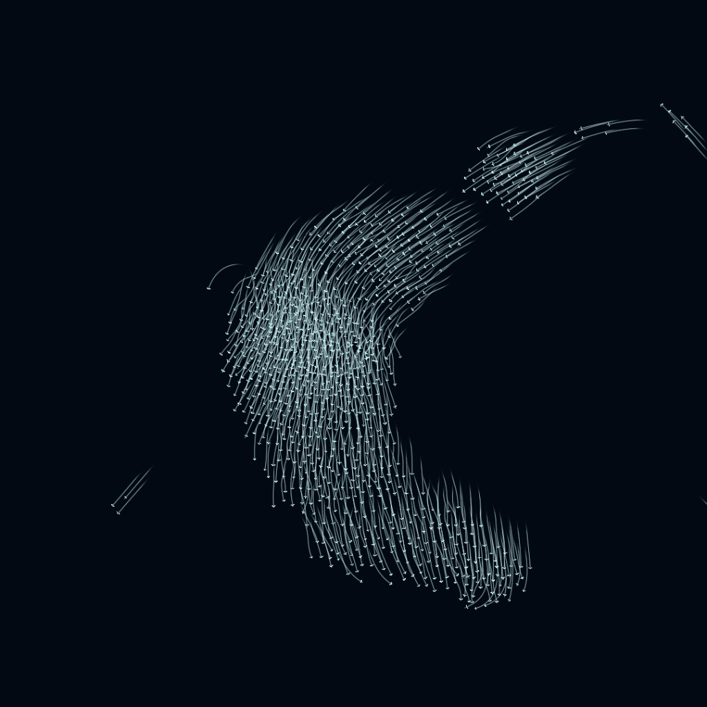

[在 Steam 创意工坊订阅 →](https://steamcommunity.com/sharedfiles/filedetails/?id=3824994256)

# 群飞 · Reynolds 鸟群壁纸 (WebAssembly 优化版)

基于经典 Reynolds Boids（雷诺兹鸟群）动力学模型的高性能实时演算动态壁纸。

本项目已全面升级为 **C++ 核心物理模拟 + WebAssembly 单线程加速 + WebGL 2 实例化批处理渲染**，彻底替代了此前的纯 JavaScript 模拟引擎。默认 1500 只鸟（支持 0–3000 只）在深色虚空中聚散、转向、振翅与留痕。



---

## 核心特性与架构升级

1. **同构 C++ 物理与紧凑近邻缓存**：
   - 核心运动学、空间哈希网格、生命周期与历史轨迹严格复用 C++ 原生实现（`native/simulation.cpp` 与 `native/web/wasm_bridge.cpp`）。
   - 保留完整的 **58 px 感知半径** 与 **15 px 分离半径**，不采用K近邻截断或距离近似。近邻扫描采用 24,000 字节的紧凑坐标缓存，减少跨越整条鸟历史读取位置的访问。
2. **免工具链、零网络、开箱即用**：
   - WebAssembly 通过 Emscripten `-sSINGLE_FILE=1` 内联进单文件胶水脚本（`boids-wasm.js`）；本次6.0.13产物直接嵌入二进制字节，不依赖Base64或外部 `.wasm` 文件。
   - **普通用户无需安装 Emscripten、Node.js 或 Python**，直接双击 `index.html` 或导入 Wallpaper Engine 即可运行；内联WASM避免额外 `.wasm` 请求与流式加载的MIME要求，已实际验证 `file://` 离线加载。仍需要支持WebGL2/WebAssembly的浏览器或宿主。
3. **性能提升实测**：
   - 对照基线为旧版本纯 JS 实现（`e0be495`）。
   - **受控动力学测试**：在 8 组相同初态空间分布与参数的纯模拟测试中，WASM 模拟耗时降低 **46.86% – 53.17%**（约 1.9–2.1 倍计算吞吐）。
   - **完整 WebGL 画面测试**：在 3000 只鸟全视口（1800×1125 绘制像素）两轮对照中，主线程回调墙钟耗时（callback wall time）从 654–733 ms/s 降低至 **384–397 ms/s**（降低约 43.64%），两端均约 60 次提交/秒，P95 提交间隔由 JS 的 33.5 / 23.7 ms 降至 WASM 的 **22.3 / 22.1 ms**。不是物理呈现率、进程CPU独占时间或功耗测量，也不保证每帧16.67ms内完成。
   - *完整测试方法、硬件环境与 10 项测试证据报告详见 [docs/验证记录.md](docs/验证记录.md)。*

---

## 使用方式

### 方式一：在 Wallpaper Engine 中使用

- **创意工坊订阅**：
  [3824994256](https://steamcommunity.com/sharedfiles/filedetails/?id=3824994256) 是既有工坊入口。**本次只更新GitHub仓库与本地运行包，没有发布Steam工坊更新**；体验本次WASM版本请按下方本地项目方式导入。
- **本地项目导入（推荐）**：
  将本仓库整个目录复制到 Wallpaper Engine 的 `myprojects` 目录下，**强烈建议使用纯英文/ASCII 目录名**（例如 `steamapps/common/wallpaper_engine/projects/myprojects/reynolds-boids/`）。
  > 本机实测WE CLI直接接收中文绝对路径时出现乱码和项目加载失败；复制到标准ASCII项目目录后验证通过。这不是对所有机器或所有WE导入方式的中文路径支持作统一判断。
- **从文件打开**：
  在 Wallpaper Engine 主界面点击左下角的「从文件打开 (Open from File)」，选择本目录下的 `project.json` 或 `index.html`。

### 方式二：在现代浏览器中直接运行

- 直接使用 Edge、Chrome 等现代浏览器双击打开 `index.html`。
- **嵌入式配置面板**：
  - 点击右上角齿轮图标，或在页面任意位置按快捷键 **`H`**，即可展开/收起深色半透明参数抽屉。
  - 在 Wallpaper Engine 桌面壁纸环境下，齿轮按钮会自动隐藏，保持桌面纯净；抽屉底部亦提供重置种子按钮与实时性能指标。

---

## 技术边界与注意事项

1. **单线程 WebAssembly 运行**：
   - 为彻底规避现代浏览器和 CEF 对 `SharedArrayBuffer` 的跨源隔离限制（COOP/COEP），WebAssembly 构建强制使用单线程串行执行（非原生 D3D11 桌面版的 8 核线程池）。
2. **模拟步长与帧率控制**：
   - 核心物理严格按 **固定 60 Hz 步长（1/60 秒）** 推进；`fps` 属性控制 WebGL 画面的渲染刷新上限。
   - WE通知暂停或页面隐藏时，主循环停止 requestAnimationFrame 调度，恢复时清空时间债务；鸟群数量归零且残影退尽后停止动画回调与绘制。这里不承诺整个宿主进程绝对零CPU或零功耗。
3. **边距与任务栏避让**：
   - 浏览器不能直接读取Win32任务栏矩形；本版本采用用户指定的任务栏方位/厚度与四边距，不自动探测多显示器任务栏布局。
   - 提供 `avoidTaskbar`（避开任务栏开关）、`taskbarPosition`（任务栏手动方位：底部/顶部/左侧/右侧）、`taskbarMargin`（避让厚度）及四周独立边距（`marginLeft` / `marginRight` / `marginTop` / `marginBottom`），方便不同屏幕与多显示器布局精确调整。
4. **设置持久化与迁移**：
   - **浏览器端**：旧版本纯 JS 版的 `localStorage` 存档不会自动迁移到新版 WASM 设置面板（数据模型与键位已全面重构）。
   - **Wallpaper Engine 端**：保留原有常用属性键，WE仍可下发同名设置；是否保留历史配置还取决于导入项目的身份与宿主存档。旧版存档自动迁移未单独验收，不承诺全部偏好无损继承。更新同名项目后请重新加载壁纸，避免旧资源缓存。

---

## 源码与开发指南

本仓库 `native/` 目录包含了全部底层 C++20 源码，既可重新编译 WebAssembly 模块，也可编译为独立的 Windows 纯原生 Direct3D 11 桌面程序。

### 1. 重新构建 WebAssembly (`boids-wasm.js`)

若对 `native/simulation.cpp` 或 `native/web/wasm_bridge.cpp` 进行了物理力学修改，可在仓库根目录下执行构建脚本重新生成内联单文件：

```powershell
# 自动检测 Emscripten 编译器并输出至根目录 boids-wasm.js
powershell -ExecutionPolicy Bypass -File .\native\build-web.ps1

# 若 em++ 未在环境变量 PATH 中，可显式指定 Emscripten SDK 路径：
powershell -ExecutionPolicy Bypass -File .\native\build-web.ps1 -EmscriptenPath "C:\path\to\emsdk\upstream\emscripten"
```

### 2. 构建 Windows 原生 Direct3D 11 独立壁纸

`native/` 目录亦包含无需浏览器与 WebAssembly 的原生 Windows 桌面程序（支持多线程并行物理模拟）：

```powershell
# 构建独立可执行程序
powershell -ExecutionPolicy Bypass -File .\native\build.ps1

# 构建原生壁纸及自动化自检与基准工具
powershell -ExecutionPolicy Bypass -File .\native\build.ps1 -Tools -Verify
```
*构建要求：支持 C++20 的 MinGW-w64 GCC（如 `g++.exe`）及 Windows SDK Direct3D 11 库。*

---

## 参数调节说明

| 参数项 | 属性 Key | 取值范围 | 默认值 | 作用与调节效果 |
| :--- | :--- | :--- | :--- | :--- |
| **鸟群数量** | `count` | 0 ~ 3000 | 1500 | 模拟的目标活跃个体数。增减时平滑进出场，设为 0 时等待残影消失后完全停帧 |
| **鸟体尺寸** | `size` | 1.0 ~ 16.0 px | 6.58 | 鸟体视觉渲染大小，不改变 58 px 感知半径与 15 px 分离半径 |
| **飞行速度** | `speed` | 20 ~ 240 px/s | 87 | 基础巡航速度。高速时位移更大，边缘转向更急促 |
| **速度差异** | `speedError` | 0.0 ~ 0.5 (0~50%) | 0.07 | 个体速度固有偏差，为 0 时全群基准航速一致 |
| **分离权重** | `separation` | 0.0 ~ 4.0 | 1.38 | 规避过近同伴（15 px 分离半径）的斥力倍率 |
| **对齐权重** | `alignment` | 0.0 ~ 4.0 | 1.00 | 向近邻同伴平均飞行朝向靠拢的协调倍率 |
| **聚合权重** | `cohesion` | 0.0 ~ 4.0 | 0.65 | 趋近近邻群体质心的吸引力倍率 |
| **边缘回转区** | `edge` | 0.0 ~ 0.35 (0~35%) | 0.175 | 靠近屏幕边界时的向内回转推力范围与强度 |
| **显示拖尾** | `trails` | 开 / 关 | 开 (true) | 是否渲染飞行轨迹拖尾。关闭可节省 GPU 光栅化开销，历史数据仍会记录 |
| **拖尾时长** | `trailDuration` | 0.1 ~ 0.5 s | 0.28 | 拖尾可见历史的时间跨度 |
| **拖尾采样率** | `trailHz` | 10 ~ 60 Hz | 30 | 拖尾分段采样密度，不影响 60 Hz 核心模拟记录频率 |
| **基准颜色** | `color` | RGB 向量 / 拾色器 | `#84d8e0` | 单色模式下的鸟体与拖尾基础颜色 |
| **鸟群渐变色** | `randomColor` | 开 / 关 | 关 (false) | 开启基于密集核心分群与领鸟传色的动态渐变配色模式 |
| **亮度 / 对比** | `brightness` / `contrast` | 0.1~2.0 / 0.5~2.0 | 1.31 / 1.20 | 渲染片元着色器色彩明暗与反差增益 |
| **避开任务栏** | `avoidTaskbar` | 开 / 关 | 开 (true) | 启用手动指定的任务栏排除矩形；触及边界仍按死亡/补生规则处理 |
| **任务栏位置** | `taskbarPosition` | bottom / top / left / right | bottom | 手动指定任务栏所在方位 |
| **任务栏厚度** | `taskbarMargin` | 0 ~ 200 px | 48 | 手动指定排除区域厚度（逻辑像素） |
| **四方边距** | `marginLeft/Right/Top/Bottom` | 各 0 ~ 200 px | 各 0 | 视口四周额外内缩的活动边界 |
| **渲染比例** | `renderScale` | 0.5 ~ 1.0 (50~100%) | 1.00 | 内部画布分辨率缩放，可在高分辨率屏幕上减轻 GPU 压力 |
| **帧率上限** | `fps` | 15 ~ 120 FPS | 60 | 渲染画面提交帧率上限 |
| **独立统计浮层** | `showStats` | 开 / 关 | 关 (false) | 是否在画面左上角常驻显示包含瞬时耗时与帧率的性能 HUD |
