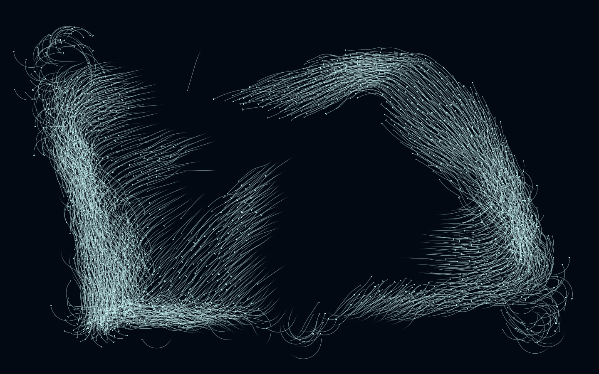

[在 Steam 创意工坊订阅 →](https://steamcommunity.com/sharedfiles/filedetails/?id=3824994256)

# 群飞 · Reynolds 鸟群壁纸

一款基于 Reynolds Boids 规则的实时鸟群动态壁纸。默认1500 只鸟在深色背景中聚散、转向，青色的短拖尾勾勒出不断变化的飞行轨迹。移动鼠标，鸟群会向两侧避让；点击画面，附近的鸟会短暂散开、加速，再重新汇入群体。

画面由程序实时演算，每只鸟根据附近同伴的位置与方向作出反应。局部的简单规则，让整个鸟群持续形成新的队形。

## 群飞规则：

首先是 Reynolds Boids 的三个规则约束：

- **分离**：与过近的同伴保持距离。
- **对齐**：向附近同伴的飞行方向靠拢。
- **聚合**：向附近群体的中心靠近。
	

改变它们的权重，可以观察鸟群从松散游走到紧密汇聚的变化。接近边缘时，鸟群会提前转向；真正触边的个体会展开、闪亮并淡出，再由画外的新个体补入。调整数量时，鸟群也会分批进入或离开画面。

## 可以怎样玩

- **调整群飞状态**：支持 0–3000 只鸟，自由调整飞行速度、个体差异，以及分离、对齐和聚合的强度。
- **完整半径群飞**：固定参考感知半径内所有有效同伴，不按 K 截断；通过空间网格与整格合计减少重复计算，近距离分离保持完整查询。
- **搭配画面风格**：调整鸟体大小、颜色、亮度、对比度和拖尾。开启空间渐变后，邻近的鸟颜色相近，随飞行平滑变色，轨迹也呈现渐变。
- **与鸟群互动**：鼠标移动带来避让，点击产生短时排斥，并让附近个体获得自身常态速度 10% 的短时增幅。
- **留出桌面空间**：独立调整四边留白，并在宿主提供可用工作区时避开任务栏。
- **暂停观察轨迹**：浏览器中按空格或点击暂停按钮，可冻结飞行；暂停时仍能调整颜色和拖尾效果。

## 使用方式

**Wallpaper Engine**：通过页首的创意工坊链接订阅并应用，在壁纸属性面板中调整效果。桌面鼠标互动取决于 Wallpaper Engine 的输入转发设置。

**浏览器**：直接打开 [index.html](index.html)，无需安装依赖、联网或构建。完整工作区也可以通过根目录的 `flock-wallpaper.html` 打开。设置面板可收起，入口地址添加 `?desktop=1` 可隐藏面板，添加 `?settings=1` 可强制显示。

项目使用 JavaScript 与 WebGL2，需要支持 WebGL2 并启用硬件加速的运行环境。正式壁纸仅使用完整半径；已终止其他近邻方案的后续工作，不再提供算法选择、K 或预测时长控件。实际流畅度取决于设备、分辨率和设置，不将浏览器提交帧率等同于桌面最终呈现或省电证明。任务栏自动避让依赖宿主提供的工作区信息，必要时可用四边留白手动补偿。

旧存档和宿主传入的 `mode`、`k`、`predictionTime`、`graphHz` 字段会被忽略，数量、颜色、速度等有效设置继续保留。更早的三模式及本轮预测实现、对比数据仅留在独立学习档案，不进入正式壁纸包。

## 关于项目

本项目探索局部规则如何形成群体运动，也希望把这种持续变化的秩序带到桌面上。模拟、轨迹与绘制均在本地运行，图片和字体资源随项目打包。

完整工作区的实现与实验结果见 [近邻模式实现与对比实验综合报告](../近邻模式实现与对比实验-综合报告.md)，实时过程见 [实验过程记录](../实验过程记录.md)。独立学习实验与旧三模式归档放在工作区 `work/experiments/`，不随正式壁纸包发布。界面使用本地 Inter 字体，许可见 [字体许可](fonts/Inter-LICENSE.txt)。
